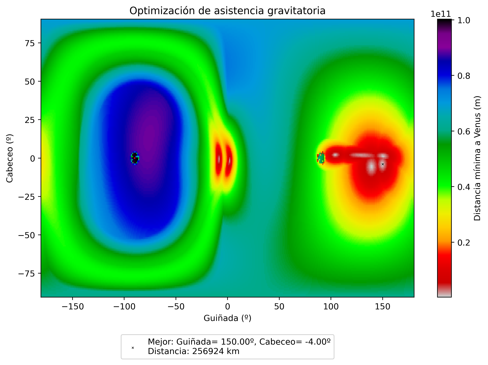
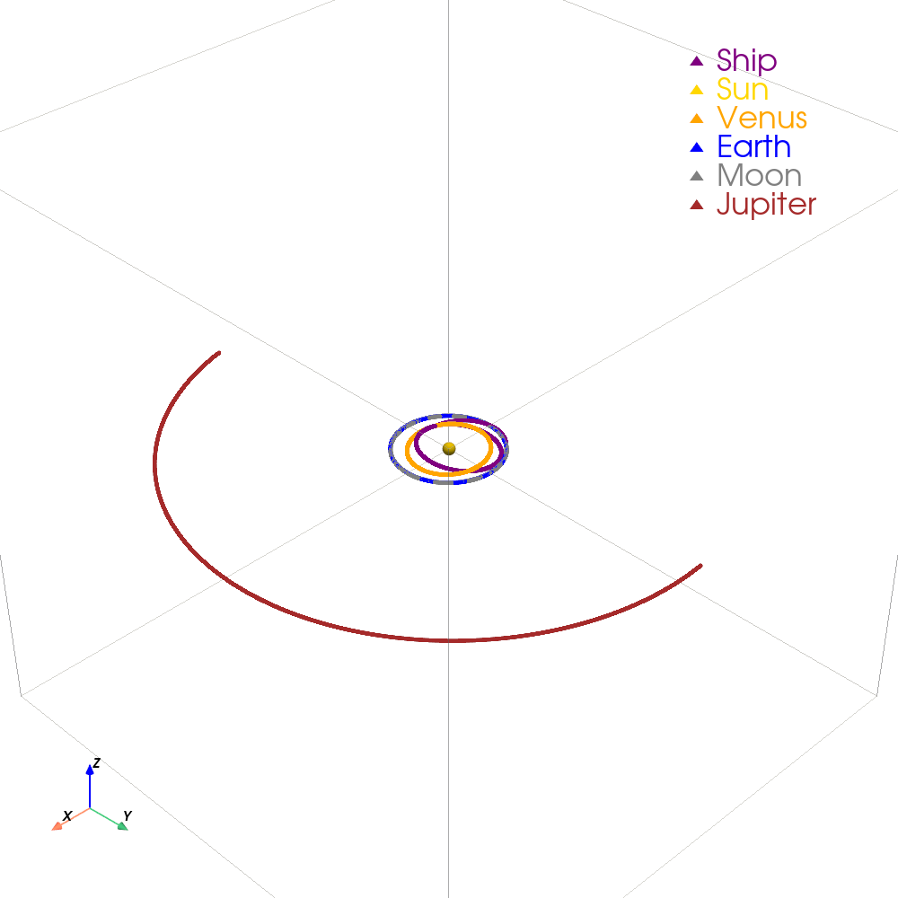
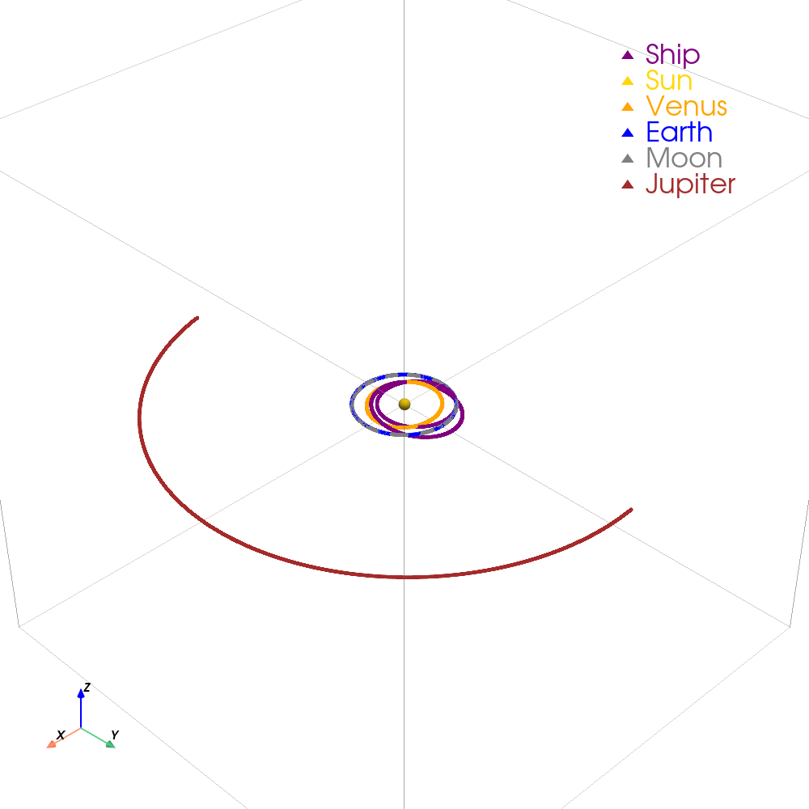
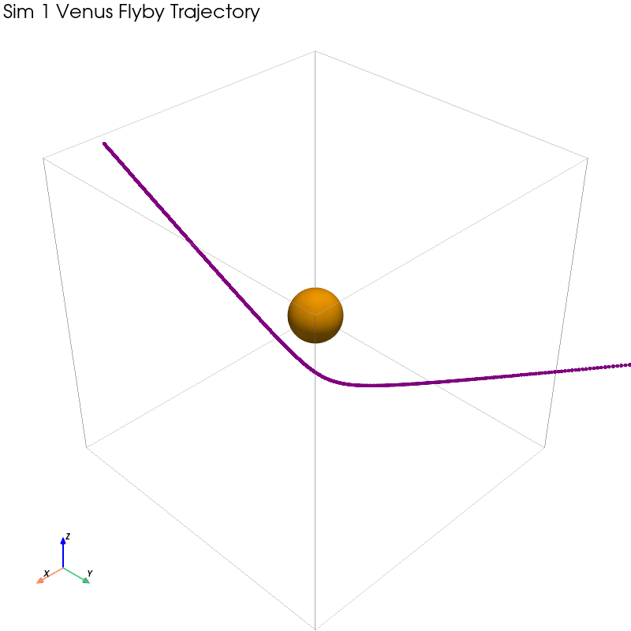
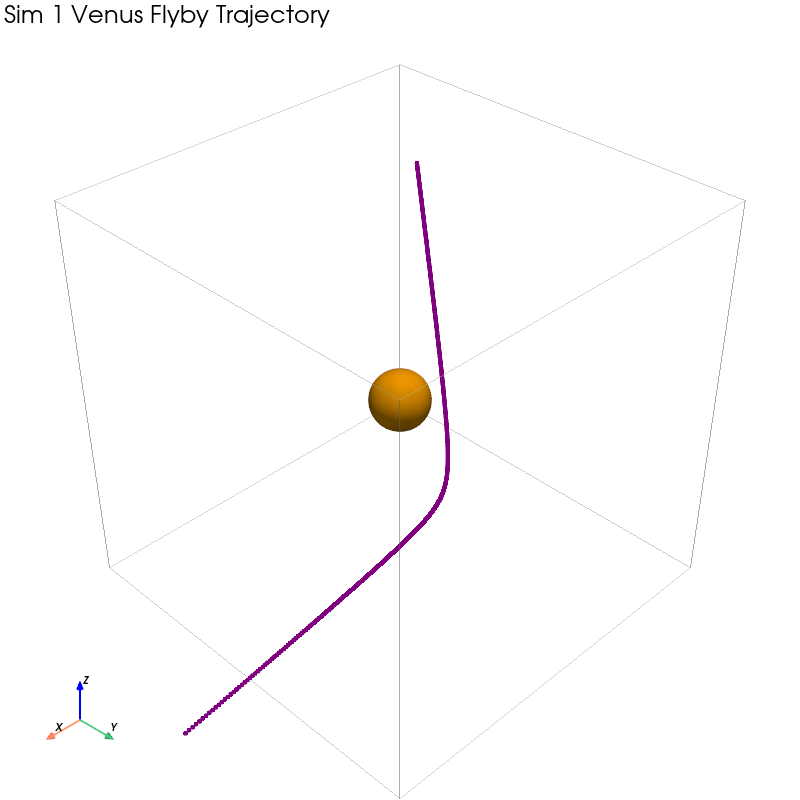
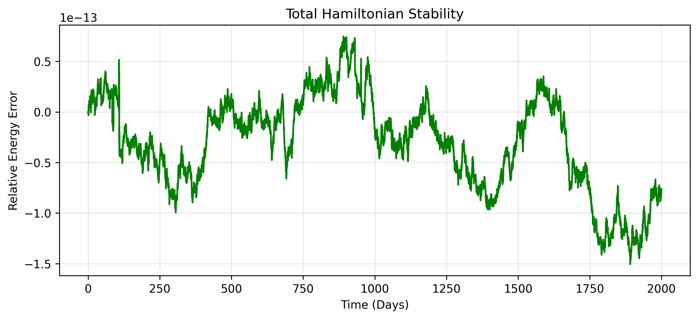
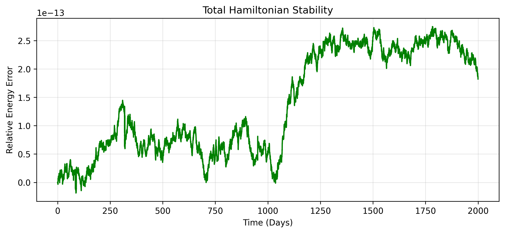

# Gravitational Assist Optimization with Adaptive RK4

3D **N-body gravitational simulator** written in **C** (OpenMP-parallelized) with Python post-processing (`PyVista`, `Matplotlib`) to optimize a **Venus gravity-assist maneuver** for a spacecraft modeled after ESA's **Solar Orbiter**.

Full technical write-up (in Spanish): [`report/report.pdf`](report/report.pdf).

---

## Physical Model & Numerical Method

- **6-Body 3D System**: Integrates the coupled gravitational dynamics of the **Spacecraft**, **Sun**, **Venus** (with its $3.4^\circ$ orbital inclination), **Earth**, **Moon**, and **Jupiter**.
- **Real Ephemerides (`ephemeris.py`)**: Fetches initial state vectors from the **NASA JPL Horizons** API at `2020-02-11 00:00:00 UTC` (~20 hours after Solar Orbiter's launch). Fixing the initial launch speed while sweeping **yaw ($\varphi$)** and **pitch ($\theta$)** turns the transfer into a 2D trajectory-optimization problem.
- **Adaptive 4th-Order Runge-Kutta (`RK4integrator.c`, `functions.c`)**:
  - Adjusts the step size dynamically with distance to Venus ($r_v$):
    $$dt = f \cdot r_v^{1/3}$$
    clamped between `min_dt` and `max_dt`, and divided by `precision_factor` inside $r_v < 10^9\text{ m}$ to resolve the hyperbolic flyby cleanly.
  - Rejects trajectories colliding with Venus or entering its upper atmosphere ($r_p \le R_V + h_{\text{atm}} = 6402\text{ km}$).
  - Conserves total system energy with relative error on the order of $10^{-14}$ to $10^{-13}$.

---

## Multi-Stage Parameter Sweep & Optimal Trajectories

Starting from a coarse $1^\circ \times 1^\circ$ global sweep (**65,341 simulations**) and zooming in down to $0.005^\circ$ (18 arcseconds), the search reveals two distinct optimal flyby families:

<p align="center">
  
</p>

| Optimal Family | Yaw ($\varphi$) | Pitch ($\theta$) | Closest Approach ($r_p$) | Effect on Spacecraft |
| :--- | :---: | :---: | :---: | :--- |
| **Solar Approach (Window 1)** | $-8.395^\circ$ | $-0.820^\circ$ | $6,848\text{ km}$ | Energy loss toward inner Solar System |
| **Outward Assist (Window 2)** | $+1.745^\circ$ | $-2.105^\circ$ | $9,023\text{ km}$ | Energy gain ($\Delta E \approx +1.70 \times 10^{11}\text{ J}$) |

### Optimal Trajectory Plots

| Solar Approach (Window 1) | Outward Assist (Window 2) |
| :---: | :---: |
|  |  |
|  |  |
|  |  |

Interactive 3D HTML orbits (`interactive_orbit_1.html`) and MP4 flyby animations (`animation_1.mp4`, `venus_flyby_centered_1.mp4`) are available inside [`report/graphs/acercamiento/`](report/graphs/acercamiento/) and [`report/graphs/alejamiento/`](report/graphs/alejamiento/).

---

## Repository Structure

```text
├── head.h                  # Physical constants, ephemeris indices, Body struct
├── simulation.c            # OpenMP parameter-sweep driver with ETA tracking
├── functions.c             # Adaptive loop, Hamiltonian diagnostics, binary I/O
├── RK4integrator.c         # 4th-order Runge-Kutta gravity engine
├── ephemeris.py            # Fetches initial state vectors from NASA JPL Horizons
├── run_sim_only.py         # Compiles and executes a simulation batch
├── graphs.py               # Generates 3D orbits, energy plots, HTMLs, and MP4s
├── heatmap.py              # Builds yaw/pitch minimum-distance heatmaps
├── ephemeris.txt           # Saved JPL Horizons initial state vectors
├── report/                 # LaTeX report source, PDF, and curated figures
└── Makefile
```

---

## Building & Running

### Requirements
- `gcc` with OpenMP support (`-fopenmp`) and `make` (or `mingw32-make` on Windows).
- Python 3 (`numpy`, `matplotlib`, `pyvista`) for plotting, heatmaps, and animations.

### Usage
```bash
# Optional: refresh JPL Horizons initial state vectors
python ephemeris.py

# Compile the C simulator
make

# Run a simulation batch without plotting
python run_sim_only.py

# Or run simulations + full 3D plots/videos pipeline
python graphs.py

# Generate minimum-distance heatmap for the latest batch
python heatmap.py
```
*(Simulation parameters such as yaw/pitch ranges, `total_t`, and adaptive `dt` bounds are configured at the top of `simulation.c`.)*
